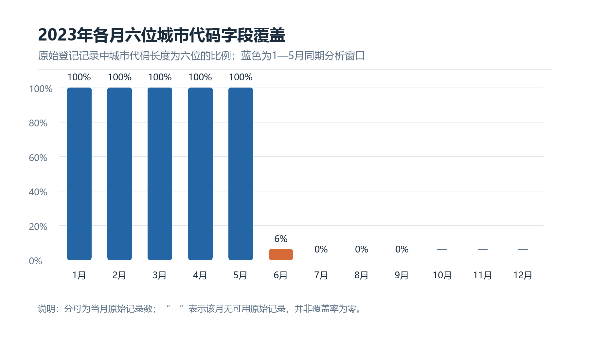
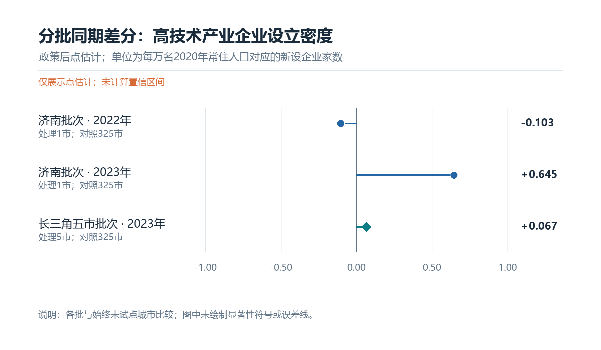
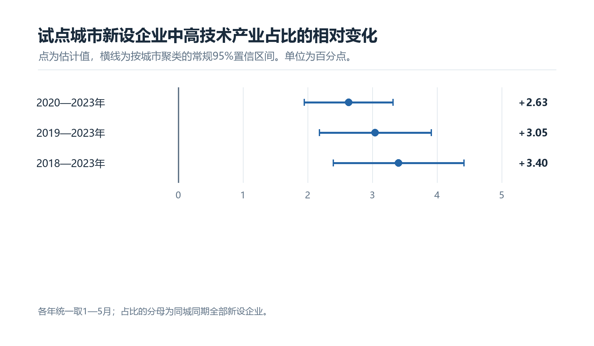

# 科创金融改革试验区与高技术产业企业进入

江洁薇娜¹　李荣耀²　王诗颖²　李俊言¹

¹ 山东财经大学工商管理学院　工商管理1班
² 山东财经大学金融学院　金融工程2班

## 摘要

科创金融改革试验区设立后，试点城市新设企业中的高技术产业占比相对上升。本文按工商登记的成立日期和行业分类统计2018—2023年各年1—5月的新设企业。2020—2023年基准样本的占比估计提高2.63个百分点（城市聚类p＜0.001）；加入2018—2019年后，估计提高3.40个百分点（p＜0.001），每万人新设高技术产业企业增加1.70家（p＝0.022）。长三角试点城市在获批前已有较快增长，政策后的相对变化需结合这一趋势解释。

**关键词**　科创金融改革试验区　企业进入　高技术产业　工商登记　双重差分

## 一、引言

科创金融改革试验区设立后，试点城市新设企业中高技术产业企业的占比是否改变？本文用工商登记资料回答这一问题：2020—2023年基准样本的占比估计相对提高2.63个百分点。济南于2021年11月获批试点，上海、南京、杭州、合肥、嘉兴于2022年11月获批，北京中关村于2023年5月获批。试验区通过科技信贷、风险补偿和知识产权融资等安排改善科技型企业的融资环境。

本文以工商登记中的成立日期界定企业进入，按登记行业识别高技术制造业和服务业。这里的“高技术产业企业”是行业分类概念，与经认定的“高新技术企业”不同。根据《高新技术企业认定管理工作指引》，企业申请认定时须已注册成立365个日历天以上，首次认定发生在设立之后。用首次认定数衡量设立，会把既有企业取得资格与新企业出现混在一起；本文的问题对应的是新企业何时成立、登记资料将其归入哪个行业。

高技术项目在取得销售收入之前，往往就要购置设备、组织研发团队。若金融机构愿意以专利等无形资产提供融资，创业者可能较早完成企业设立。若新增贷款主要流向经营多年的科技企业，政策作用可能先体现在在位企业的研发和设备投入上。两种资金去向对企业设立数量的含义不同。

本文汇总2018—2023年各年1—5月的工商登记。以2020—2023年为基准样本，再依次纳入2019年和2018年。按试验区总体方案印发后的首个完整年度确定政策起点，估计包含城市和年份固定效应的模型。另以从未试点城市作对照，分别追踪济南和长三角五市的变化。

四年基准样本中，试点城市新设企业的行业构成向高技术产业倾斜；增加政策前观察年份后，占比估计仍为正。长三角五市获批前已有较快增长，因此合并估计需要结合分批差分结果解读。

本文考察的是2021年以后分批设立的科创金融改革试验区。企业是否新设由成立日期界定，属于哪类产业由国家统计局目录界定。由此可以分别观察同等人口规模下新设了多少家高技术产业企业，以及它们在当地创业活动中占多大比重。

## 二、政策背景与作用机制

### （一）试验区的政策安排

三批试验区的总体方案分别于2021年、2022年和2023年印发，落在济南、长三角五市和北京中关村。方案提出科技信贷、知识产权质押融资、风险补偿等安排，直接作用对象是融资交易。它们与全国统一的高新技术企业认定条件属于不同制度，不能用认定数直接推断新企业获得贷款的情况。

主分析从方案印发后的首个完整年度起计处理：济南为2022年，长三角五市为2023年，北京中关村为2024年。印发年份作为过渡期，从对应试点城市的估计样本中剔除；印发当年起算是可另作检验的处理时点。样本止于2023年，因此北京中关村尚无主定义下的政策后年度。同时，试验区边界位于北京市内，而登记资料仅能汇总到北京市全市。基准估计排除北京，描述统计保留北京。

### （二）可检验的机制

设立高技术产业企业通常需要在形成稳定收入之前支付研发、设备和人员成本。若风险补偿降低银行服务年轻企业的预期损失，或知识产权融资使技术资产更易用于融资，资金约束可能在企业设立边际上松动。另一方面，贷款准入条件、知识产权形成时间及企业资质要求可能使政策工具先覆盖已成立企业。试验区出台与新企业设立之间因而可能有时滞，且不同批次的观察长度不同。

现有登记数据只记录成立与行业，不记录融资申请、贷款发放或受贷企业年龄。本文能检验新设企业数量和结构是否与上述渠道相容，不能据此判定具体金融工具已经作用于创业者。后续若获得贷款投向、受贷企业年龄及政策工具覆盖资料，可把资金服务与进入变化相连。城市贷款余额占地区生产总值的比重只刻画一般金融状况，不足以替代这类直接信息。

### （三）研究命题

命题一　试验区实施后，试点城市每万人新设高技术产业企业数相对增加。

命题二　试验区实施后，试点城市全部新设企业中高技术产业企业所占比重相对上升。

## 三、文献综述

### （一）制度变化与企业设立

企业进入的经验度量首先取决于何种事件被记录。倪鹏途、陆铭（2016）利用人口调查和家庭数据研究个人的创业选择，观察单位是个人；毕青苗等（2018）利用工业企业数据库，研究行政审批中心设立与达到统计规模门槛的企业进入。工业企业库的进入既可能来自企业新设，也可能来自既有企业越过规模门槛。工商登记资料直接记录企业成立，适合回答某一时期、某一地区新设了多少企业。

采用工商登记的研究又因研究问题选择不同的分母。何雨可等（2024）按人口调整城市新创企业数量，用于比较不同规模城市的创业活跃度；谢申祥、李彦君（2025）以期初存续企业为分母计算进入率，用于研究市场准入规则与企业更替。Barwick等（2025）把商事登记改革与注册、年报资料联结，同时观察制造业企业的进入和退出。本文研究设立时点的高技术产业企业数量，采用固定的2020年常住人口作规模调整；该量是“每万人新设数”，不是以企业存量为分母的进入率，也不包含企业后续退出。

### （二）融资约束与创业进入

金融约束提供了政策影响设立的理论起点。Evans和Jovanovic（1989）的创业选择模型强调，预期收益之外，创业者还须筹足启动资本；Aghion等（2007）发现，金融可得性对小企业及依赖外部融资行业的进入尤为重要。由此推论，试验区若把资金服务延伸至年轻企业，可能影响高技术项目的设立边际。但这一推论取决于资金是否实际抵达潜在创业者。

银行监管改革为检验融资供给与创业的关系提供了经验依据。Black和Strahan（2002）发现美国银行业监管放松后新企业注册增加。Cetorelli和Strahan（2006）将银行竞争与小企业在当地产业中的分布联系起来。Kerr和Nanda（2009）进一步发现，银行准入改革后，新进入以及进入后很快退出的企业均有增加。在中国，王贤彬等（2025）利用小微支行在不同县区先后设立的差异，发现开设支行后当地小微企业进入率提高，技术密集行业的反应更为明显。

### （三）科技金融政策、创业与在位企业

以早期“促进科技和金融结合试点”为对象，邢小明等（2024）发现试点城市的创业活跃度提高。吉文军、刘文慧（2026）将研究对象缩小到科技服务业，也观察到新企业进入增加。储佩佩、张娆（2025）专门讨论科技金融试点与高技术企业进入率。蔡文心等（2026）则把潜在经营主体的创业活动与在位企业的经营活力分别考察。几项研究虽然都涉及科技金融，所观察的对象分别是城市创业活动、特定行业的新设企业以及企业进入率，分子和分母各有含义。

政策作用于在位企业的证据更容易在财务和专利资料中观察。朱仁泽等（2023）发现，科技金融结合试点改善了制造业上市企业的投融资期限匹配。康艳玲等（2023）考察了科技金融对企业创新及高质量发展的作用。邱洋冬（2023）进一步区分企业是否开始研发与已开展研发的企业增加多少投入，发现政策反应集中在后者。Howell（2017）发现美国早期研发资助改善了申请企业后续融资和创新表现。Xin等（2022）发现中国小银行进入与当地工业专利产出增加有关。这些结果刻画的是企业已有项目之后的资金配置，与企业能否完成设立处在不同环节。

### （四）本文的研究位置

本文研究2021年以后分批设立的科创金融改革试验区。与早期科技和金融结合试点相比，这项改革的实施城市和时点不同。本文同时考察高技术制造业和高技术服务业，并明确区分两项结果：每万人新设高技术产业企业数衡量进入数量；高技术产业企业在全部新设企业中的占比衡量行业构成。两项结果使用相同的高技术产业新设企业计数。

试验区分批落地还带来估计上的挑战。Goodman-Bacon（2021）说明，不同处理时间下的双向固定效应汇合了多种组间比较。本文因此补充以从未试点城市为对照的分批同期差分，其比较思路参照Callaway和Sant’Anna（2021）。Conley和Taber（2011）提醒，政策变化单位很少时，大量对照城市不能自动保证常规聚类推断可靠。本文同时报告合并估计与政策前后的分批变化。

## 四、数据、变量与识别设计

### （一）数据与样本

2018—2023年六个分年工商文件共含115,166,969条原始记录。分年度提取成立日期、信用代码、企业类型、地级市和登记行业。每年先按成立日期截取1—5月，同一非空信用代码保留成立日期最早的一条，再剔除个体工商户、分支机构等非企业主体。保留后来注销或吊销的企业，避免把已退出的创业者从历史新设数中删去。城市按登记文件所载市码归属。源文件带有RStata处理标识，来源及许可见随包说明。

2023年原始文件中的成立日期截至9月21日。当年6月只有约6.1%的原始记录具有标准城市代码，7—9月该字段全部缺失。为使各年覆盖相同月份，统一取1—5月。按各城市应纳入的年份要求完整同期数据后，四年、五年和六年样本分别包含331、330和329个城市，对应1,318、1,644和1,968个城市年度观测。

### （二）被解释变量

本文设置两个被解释变量。第一项是进入密度：令N_ct为城市c在年份t的1—5月新设高技术产业企业家数，P_c为该市2020年第七次全国人口普查常住人口，则Y_ct＝10,000×N_ct÷P_c，单位为家/万人。非空信用代码相同的记录在年度窗口内只计一次。人口取自Dong等（2022）整理的普查公报，并按登记市码对齐行政边界。固定人口分母使同一城市的年度变动来自新设家数。该指标不同于以期初存续企业为分母的企业进入率。

第二项是新设企业的高技术产业占比：令A_ct为同城同期经过相同去重和主体类型筛选的全部新设企业数，S_ct＝100×N_ct÷A_ct，模型系数的单位为百分点。占比变化可能来自高技术产业或其他行业的新设数变化，因此还须结合进入密度判断。直接新设家数和log(1+新设家数)作为补充结果。

高技术制造业和高技术服务业分别依据国家统计局2017年制造业分类和2018年服务业分类识别。先用登记资料中的有效行业代码匹配分类目录；代码不完整时，仅当其上级行业整体属于同一高技术类别，才将该企业计入。分类目录中只涵盖部分经营活动的行业不计入，清洗审计另列候选数。

### （三）处理变量与估计

试点城市从总体方案印发后的首个完整年度起取处理值1，从未试点的城市取0。济南自2022年、上海等五市自2023年开始处理；两批城市在各自方案印发年分别属于过渡期，对应观测从回归中剔除。北京中关村按同一规则要到2024年才进入处理期，政策边界又小于北京市全市，故仅保留在描述统计中。

基准模型设定如下。

Y_ct＝βD_ct＋μ_c＋λ_t＋ε_ct　　（1）

其中D_ct是政策实施指标，μ_c吸收城市常年差异，λ_t吸收共同年份变化。Y_ct取进入密度时，β的单位为家/万人；取S_ct时，β的单位为百分点。标准误按城市聚类。分批估计以从未试点城市为对照，比较处理组与对照组从同一基期至目标年份的变化。济南以2020年为基期，长三角五市以2021年为基期；扩展样本还可用2018及2019年检查更早的相对变化。分批处理的双向固定效应系数综合不同组间比较，因此分批差分与基准系数一并报告，不将其视为同一统计量。

样本期内仅六个城市进入处理期。常规显著性检验采用城市聚类标准误。解释结果时还需结合各批次的政策前走势和行业字段的跨年覆盖。

## 五、估计结果

### （一）登记覆盖与筛选

2018年1—5月有7,906,479条原始登记，按统一规则筛选后可识别416,682家新设高技术产业企业。2019—2023年同期依次为454,251、461,860、598,872、542,894、662,824家。这是清洗阶段的总数；回归还要求城市具有完整的同期记录。2018年有2.2%的同期记录按有效信用代码去重，2019年为2.3%。附表1列出各年筛选与行业匹配数，附表2列出试点地区。

2023年6月起，登记资料的城市字段覆盖明显下降（图1）。为使各年可比，本文统一使用1—5月的记录。行业匹配、主体筛选和城市覆盖的逐年数量见附表1及研究包的清洗审计。

### （二）基准结果与样本扩展

表1　试点实施前后新设企业行业占比和进入密度的相对变化

| 各年1—5月 | 高技术产业占比（百分点） | 每万人新设高技术产业企业数（家） |
| --- | ---: | ---: |
| 2020—2023年 | 2.634（0.350，<0.001） | 1.094（0.681，0.109） |
| 2019—2023年 | 3.045（0.440，<0.001） | 1.259（0.737，0.088） |
| 2018—2023年 | 3.405（0.514，<0.001） | 1.697（0.739，0.022） |

注　括号内依次为城市聚类标准误、p值。占比的分母是同城同期全部新设企业；每万人新设数以2020年常住人口为基数。回归控制城市和年份固定效应，按城市聚类标准误。四年、五年和六年样本分别有1,318、1,644和1,968个城市年度观测。

表1显示，基准样本中高技术产业企业占全部新设企业的比重相对提高2.63个百分点。这是新设企业行业构成的变化；占比变化还取决于其他行业的新设企业数。

以每万名常住人口计算，基准样本中试点城市同期新设高技术产业企业相对增加1.09家，城市聚类p值为0.109。依次剔除六个试点城市后，估计介于0.66与1.46家之间（附表3）。附表5列出采用新设家数和对数家数的补充估计。

把2019年加入政策前观察后，占比估计为3.05个百分点（p＜0.001）。再向前加入2018年，占比估计为3.40个百分点（p＜0.001），每万人新设数增加1.70家（p＝0.022）。

### （三）分批差分

分批差分使比较对象和起点更具体。2020—2023年基准样本中，以2020年为基期，济南2022年和2023年的每万人新设数相对变化分别为-0.103家和0.645家；以2021年为基期，长三角五市2023年的相对变化为0.067家。五市在政策前的2020—2021年，相对于从未试点城市已上升约2.394家/万人，量级超过2021—2023年的政策后差分。图2显示各批次的点估计。

将样本延至2018年后，长三角五市从2018年至2021年的每万人新设数已比未试点城市多增加2.90家。相同五市在2021—2023年的相对变化仅为0.06家。较长的观察期表明，五市在获批前已经出现较快增长，解释合并估计时须考虑这一差异。图3并列给出各样本下占比的估计及区间。

### （四）覆盖与样本窗口

上述比较依次向前增加完整年份。另一项检查将窗口延至8月，以判断2023年市码缺失的影响。本文依原始省市名称恢复2023年部分缺失城市码，只保留与该年已有城市码高度一致的同名记录。统一扩展至各年1—8月后，进入密度估计为-4.237家/万人（附表4）。2023年7月和8月的行业字段仍不完整，因此该结果仅用于判断资料覆盖问题。

### （五）政策选择与后续识别

试点城市的金融基础、产业集聚和创业趋势可能影响获批，也可能影响高技术产业进入。长三角五市在政策前已有明显的相对变化，因而城市固定效应和年份固定效应本身不足以解决选择问题。若取得正式评审分数、获批门槛和落选城市名单，可检验阈值附近是否存在更可比的城市；若取得政策前银行网点、外部信贷供给及企业实际受贷记录，可分析资金服务的覆盖对象与机制。现有材料主要是公开方案和工商登记，本文报告同期差分关联及其敏感性，所需补充数据和工具变量候选见复现包。

## 六、结语

在本文的登记资料和行业归类规则下，试点实施后，试点城市新设企业中的高技术产业占比相对提高。四年、五年和六年样本的估计分别为2.63、3.05和3.40个百分点。六年样本中，每万人新设高技术产业企业相对增加1.70家。长三角五市在获批前已有较快增长，政策效果仍需在更可比的政策前趋势下检验。

对试验区的跟踪评估可以把设立登记与首贷记录衔接起来，区分获得资金的是当年新设企业还是已经营多年的企业。就现有资料而言，长三角五市在获批前已经出现高技术产业进入密度相对上升。要分辨试验区在多大程度上改变了企业设立决策，还需要连续覆盖政策前后、行业代码可比的登记资料。

## 参考文献

毕青苗、陈希路、徐现祥、李书娟，2018：《行政审批改革与企业进入》，《经济研究》第2期，第140—155页。

蔡文心、杜旭虹、张洪胜、武鑫、张婉玲，2026：《科技金融、经营主体活力与经济高质量发展》，《财经论丛》第42卷第6期，第77—88页。

储佩佩、张娆，2025：《科技金融试点政策对高技术企业进入率的影响及作用机制》，《科技管理研究》第45卷第18期，第20—33页。

何雨可、牛耕、逯建、赵国昌，2024：《数字治理与城市创业活力——来自“信息惠民国家试点”政策的证据》，《数量经济技术经济研究》第1期，第47—66页。

吉文军、刘文慧，2026：《科技金融政策与科技服务业新企业进入》，《工业技术经济》第45卷第2期，第56—66页。

康艳玲、王满、陈克兢，2023：《科技金融能促进企业高质量发展吗？》，《科研管理》第44卷第7期，第83—96页。

倪鹏途、陆铭，2016：《市场准入与“大众创业”：基于微观数据的经验研究》，《世界经济》第4期，第3—21页。

邱洋冬，2023：《科技与金融“联姻”如何影响企业研发决策？》，《南京财经大学学报》第1期，第54—64页。

王贤彬、许婷君、严祥起，2025：《普惠小微信贷供给与小微企业进入——来自小微支行设立的证据》，《金融研究》第12期，第95—113页。

谢申祥、李彦君，2025：《制度型开放与市场活力——来自“市场准入负面清单”试点的证据》，《南开经济研究》第8期，第3—22页。

邢小明、应兆琦、章文颖，2024：《科技金融政策能否提升城市创业活跃度——基于“促进科技和金融结合试点”的准自然实验》，《东北财经大学学报》第4期，第74—86页。

朱仁泽、陈享光、李光武，2023：《科技金融结合试点政策对企业期限错配的影响》，《经济经纬》第40卷第1期，第130—140页。

国家统计局，2017：《高技术产业（制造业）分类（2017）》。

国家统计局，2018：《高技术产业（服务业）分类（2018）》。

国家质量监督检验检疫总局、国家标准化管理委员会，2017：《国民经济行业分类》（GB/T 4754—2017，按第1号修改单修订）。

科技部、财政部、国家税务总局，2016，《高新技术企业认定管理工作指引》（国科发火〔2016〕195号）。

科技部、财政部、国家税务总局，2016：《高新技术企业认定管理办法》（国科发火〔2016〕32号）。

中国人民银行等，2021：《山东省济南市建设科创金融改革试验区总体方案》（银发〔2021〕298号）；2022：《上海市、南京市、杭州市、合肥市、嘉兴市建设科创金融改革试验区总体方案》（银发〔2022〕260号）；2023：《北京市中关村国家自主创新示范区建设科创金融改革试验区总体方案》（银发〔2023〕98号）。

Aghion, P., T. Fally, and S. Scarpetta, 2007, “Credit Constraints as a Barrier to the Entry and Post-Entry Growth of Firms,” Economic Policy, 22(52), 732–779.

Barwick, P. J., L. Chen, S. Li, and X. Zhang, 2025, “Entry Deregulation, Market Turnover, and Efficiency: China’s Business Registration Reform,” Review of Economics and Statistics, online ahead of print, DOI: 10.1162/rest_a_01549.

Black, S. E., and P. E. Strahan, 2002, “Entrepreneurship and Bank Credit Availability,” Journal of Finance, 57(6), 2807–2833.

Callaway, B., and P. H. C. Sant’Anna, 2021, “Difference-in-Differences with Multiple Time Periods,” Journal of Econometrics, 225(2), 200–230.

Cetorelli, N., and P. E. Strahan, 2006, “Finance as a Barrier to Entry: Bank Competition and Industry Structure in Local U.S. Markets,” Journal of Finance, 61(1), 437–461.

Conley, T. G., and C. R. Taber, 2011, “Inference with ‘Difference in Differences’ with a Small Number of Policy Changes,” Review of Economics and Statistics, 93(1), 113–125.

Dong, L., R. Du, and Y. Liu, 2022, “Mapping Evolving Population Geography in China,” Working Paper.

Evans, D. S., and B. Jovanovic, 1989, “An Estimated Model of Entrepreneurial Choice under Liquidity Constraints,” Journal of Political Economy, 97(4), 808–827.

Goodman-Bacon, A., 2021, “Difference-in-Differences with Variation in Treatment Timing,” Journal of Econometrics, 225(2), 254–277.

Howell, S. T., 2017, “Financing Innovation: Evidence from R&D Grants,” American Economic Review, 107(4), 1136–1164.

Kerr, W. R., and R. Nanda, 2009, “Democratizing Entry: Banking Deregulations, Financing Constraints, and Entrepreneurship,” Journal of Financial Economics, 94(1), 124–149.

Xin, F., J. Zhang, Y. Guo, and S. Liang, 2022, “Banking Structure Change and Corporate Innovation: Evidence from Chinese City-Branch Data,” Accounting & Finance, 62(S1), 2057–2084.

## 附录

附表1　2018—2023年各年1—5月登记清洗与行业匹配

| 年度 | 原始登记 | 去重剔除 | 类型剔除 | 制造业 | 服务业 | 高技术合计 |
| --- | ---: | ---: | ---: | ---: | ---: | ---: |
| 2018 | 7,906,479 | 174,675 | 5,194,110 | 34,600 | 382,082 | 416,682 |
| 2019 | 8,628,813 | 194,286 | 5,761,704 | 29,328 | 424,923 | 454,251 |
| 2020 | 8,439,569 | 205,621 | 5,590,462 | 50,480 | 411,380 | 461,860 |
| 2021 | 7,434,880 | 126,235 | 4,173,126 | 62,793 | 536,079 | 598,872 |
| 2022 | 7,499,646 | 93,874 | 4,669,869 | 49,447 | 493,447 | 542,894 |
| 2023 | 8,828,378 | 168,090 | 5,233,650 | 66,361 | 596,463 | 662,824 |

注　原始登记按成立日期截取同期。信用代码中含异常嵌入式 NUL 字节的记录不按该字段判重；正常的尾部填充字节不受影响。2018年和2019年进入扩展样本。

附表2　七个试点城市2018—2023年同期新设高技术产业企业数

| 城市 | 2018年 | 2019年 | 2020年 | 2021年 | 2022年 | 2023年 |
| --- | ---: | ---: | ---: | ---: | ---: | ---: |
| 济南 | 4,430 | 7,047 | 6,971 | 8,092 | 7,423 | 8,300 |
| 上海 | 22,415 | 24,149 | 29,354 | 44,639 | 22,868 | 42,402 |
| 南京 | 7,593 | 8,555 | 8,191 | 9,214 | 8,509 | 8,580 |
| 杭州 | 13,347 | 13,022 | 12,365 | 15,308 | 14,198 | 18,488 |
| 合肥 | 6,184 | 9,292 | 7,013 | 10,474 | 11,199 | 11,465 |
| 嘉兴 | 1,150 | 1,187 | 1,456 | 1,731 | 1,288 | 1,868 |
| 北京 | 29,699 | 26,726 | 20,297 | 32,749 | 28,345 | 37,360 |

注　各年均为1—5月。2018年和2019年进入扩展样本；描述表保留北京和各批政策过渡年。

附表3　逐一剔除试点城市的固定效应估计

| 剔除城市 | 每万人新设数系数 | 城市聚类标准误 | 城市年度观测数 |
| --- | ---: | ---: | ---: |
| 济南 | 1.264 | 0.784 | 1,315 |
| 上海 | 1.002 | 0.803 | 1,315 |
| 南京 | 1.461 | 0.666 | 1,315 |
| 杭州 | 0.656 | 0.591 | 1,315 |
| 合肥 | 0.855 | 0.752 | 1,315 |
| 嘉兴 | 1.333 | 0.754 | 1,315 |

附表4　不同观察窗口的进入密度估计

| 窗口 | 每万人新设高技术产业企业数系数 | 城市年度观测数 |
| --- | ---: | ---: |
| 2020—2023年1—5月 | 1.094 | 1,318 |
| 2019—2023年1—5月 | 1.259 | 1,644 |
| 2018—2023年1—5月 | 1.697 | 1,968 |
| 2020—2023年1—8月，补码后 | -4.237 | 1,242 |

注　系数单位为每万人新设企业数。1—8月系数仅作资料覆盖诊断，7—8月高技术计数受行业字段断档影响。

附表5　同期新设高技术产业企业家数及对数的估计

| 样本 | 新设数（家） | log(1＋新设数) |
| --- | ---: | ---: |
| 2020—2023年 | 1,969.273（1,011.627，0.052） | 0.011（0.055，0.848） |
| 2019—2023年 | 2,553.043（1,509.987，0.092） | -0.002（0.057，0.972） |
| 2018—2023年 | 3,209.030（1,741.104，0.066） | 0.033（0.054，0.544） |

注　括号内依次为城市聚类标准误、p值。
